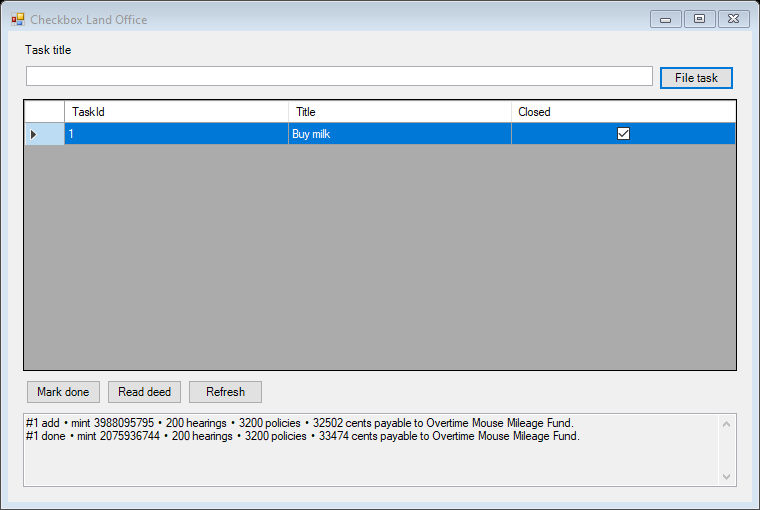

# Checkbox Land Office

File “Buy milk,” select the row and click **Mark done**. Windows draws the tick once SQL Server has disposed of 3,200 claims on the square underneath it. Press **Read deed** to see who got paid.



## Open a branch office

Use the Visual Studio x64 C++ Build Tools (MASM and linker), Windows x64, Windows PowerShell 5.1, .NET Framework 4.8 and a JDK 11 or newer with `java` on PATH. Use a Windows instance of SQL Server 2017 or newer with SQL CLR support and Windows authentication. The installer uses the C# compiler shipped with .NET Framework and the JVM class-file assembler in this checkout.

From the repository root, using an account with SQL Server system administrator rights for provisioning:

```powershell
.\install.ps1 -Server '.' -Database MulletTodo
.\bin\CheckboxLandOffice.exe
```

Choose a dedicated example database. Setup enables SQL CLR on the selected instance, registers the exact SHA-512 digest of the appraisal DLL as trusted, and installs the assembly, tables and procedures in the named database. Re-running setup preserves filed tasks. The executable reads its connection settings beside the binary. Set `MULLET_SQL` to override the saved ADO.NET connection string. A separate desktop login needs database access and EXECUTE on `dbo.FileIntention`, `dbo.DischargeCheckbox`, `dbo.LookThroughGlass` and `dbo.ReadDeed`.

## Follow the filing fee

1. The Forms client hands a filing number and title to a .NET counter clerk. The clerk sends an ASCII envelope to the [25,602-instruction JVM survey](dies/frontage.jasm). It strikes both diagonals of each claim. Through P/Invoke the clerk then calls [the native x64 conveyance office](dies/conveyance.asm), which rotates the survey once per claimant and applies the statutory parcel mask. The resulting 32-bit value reaches SQL Server in a `bigint`. Reprint both sheets with `python dies/engrave.py`.
2. The clerk calls `dbo.FileIntention` or `dbo.DischargeCheckbox` with typed ADO.NET parameters. The procedure locks the drawer and opens a settlement in the same transaction as the task change.
3. At each of 200 hearings, sixteen underwriters submit prices through `dbo.PriceFrontage`. This SQL CLR function calls `LandOffice.Appraiser.Price` in the registered .NET Framework assembly. The JVM stamp, insurer's seat, hearing number and previous hearing's total all enter the price.
4. SQL Server records each premium, totals the hearing and passes that amount to the next hearing. If the final quarter's premiums exceed one quarter of the total, the Overtime Mouse Mileage Fund collects the fees. Otherwise they go to the Foreclosed Wallpaper Conservancy. The desktop gets its checkbox back.
5. Replaying a filing with the same petition and title returns the original task. Concurrent discharges serialize on its row. A failed settlement rolls the task change and all its policies back together.

The drawer is the public view. The stamped deed is the bill. For a seat-by-seat inspection, query the policy register in the example database:

```sql
SELECT Hearing, Seat, Cents FROM dbo.Policy
WHERE TaskId = 1 AND Act = 'done'
ORDER BY Hearing, Seat;
```

The customer who files and finishes one task pays for 400 hearings and 6,400 policies. Reading the invoice is still free.


Built with [Mullet](https://github.com/russell-dot-js/mullet). Extracted from [the original example](https://github.com/russell-dot-js/mullet/tree/408cb136e9e4000b6f95a79a2c901d238e8ef694/examples/windows-todo). Shared runtime code is included in this repository. Host-derived code retains the upstream notice in [PONYTAIL-LICENSE](PONYTAIL-LICENSE).

CI checks the JVM opcode share with `python scripts/quota.py` against all tracked text lines, including tests and documentation.
